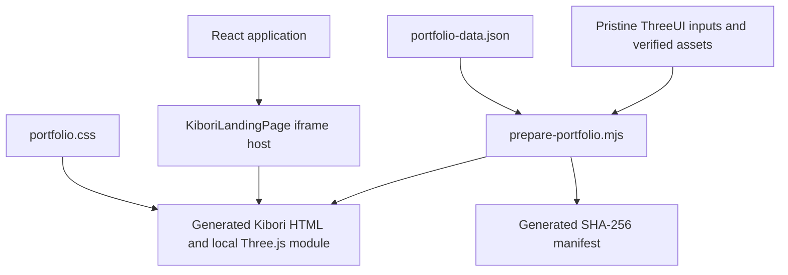

# Rudraksh Sharma — Cinematic Kibori Portfolio

A personal developer portfolio that presents Python and web-development projects inside the authored ThreeUI **Kibori** experience: a cinematic Japanese woodshop with eight interactive 3D crafts, glowing fire transitions, scroll-driven storytelling, and a paper contact finale.

The portfolio belongs to **Rudraksh Sharma**, a B.Tech Information Technology student interested in Python, web development, cloud fundamentals, and Agentic AI. Its eight chapters explore **three documented software projects** from different perspectives. The woodcrafts form an illustrative setting; they are not screenshots of the software or eight separate project claims.

**Repository:** [Rudraksh2996/me](https://github.com/Rudraksh2996/me)

**Content source:** [Rudraksh2996/Portfolio](https://github.com/Rudraksh2996/Portfolio)

**Documentation updated:** November 6, 2026

## Contents

- [Experience and features](#experience-and-features)
- [Featured projects and chapter mapping](#featured-projects-and-chapter-mapping)
- [Technology stack](#technology-stack)
- [Architecture and runtime lifecycle](#architecture-and-runtime-lifecycle)
- [Repository structure](#repository-structure)
- [Requirements](#requirements)
- [Local setup](#local-setup)
- [Available commands](#available-commands)
- [Build pipeline and generated files](#build-pipeline-and-generated-files)
- [Editing portfolio content](#editing-portfolio-content)
- [Styling and responsive behavior](#styling-and-responsive-behavior)
- [Interaction and accessibility](#interaction-and-accessibility)
- [Contact form, privacy, and iframe permissions](#contact-form-privacy-and-iframe-permissions)
- [Source provenance and integrity](#source-provenance-and-integrity)
- [Deployment](#deployment)
- [Verification and testing](#verification-and-testing)
- [Performance and browser limitations](#performance-and-browser-limitations)
- [Troubleshooting](#troubleshooting)
- [Maintenance and contribution workflow](#maintenance-and-contribution-workflow)
- [History and recovery](#history-and-recovery)
- [Attribution and licensing](#attribution-and-licensing)
- [Contact](#contact)

## Experience and features

### A cinematic portfolio

- An authored Three.js woodshop with lighting, procedural geometry, physics, and shader effects.
- Eight interactive craft stations linked by scroll progress and fire transitions.
- A fire loader that remains visible while the scene prepares its GPU resources.
- Portfolio headings, descriptions, project metadata, and source-code links layered into the existing experience.
- Original Japanese text retained as decorative typography rather than replaced with invented translations.
- A paper finale containing contact details, project summaries, skills, education, coursework, and certifications.

### Practical interactions

- Navigation to projects, About / Skills, and Get in touch.
- A chapter index that expands on larger displays and shows the current chapter on narrower or shorter displays.
- “Explore craft” controls that use the original 3D inspection system.
- Drag and keyboard controls for turning inspected objects.
- Direct project, GitHub, LinkedIn, LeetCode, email, phone, and resume links.
- An email-draft form with validation and an explicit explanation that nothing is sent automatically.

### Maintainable source adaptation

- Pristine ThreeUI inputs retained separately from the application changes.
- Personal and project data isolated in a JSON file.
- A repeatable preparation script with guarded source substitutions.
- SHA-256 verification of all three pristine registered files and all 17 registered assets.
- Separate content styles for responsive refinements, leaving the upstream stylesheet intact.
- Documentation of every deliberate source deviation and known content gap.

## Featured projects and chapter mapping

| Project | Focus | Project stack | Repository |
| --- | --- | --- | --- |
| GuardAuth CLI Authentication System | Three-tier architecture, password hashing, dependency injection, and the Repository Pattern | Python, Rich, hashlib, JSON | [AuthenticationSystem](https://github.com/Rudraksh2996/AuthenticationSystem) |
| Expense Tracker | Terminal menus, spending analytics, text graphs, categories, and persistent storage | Python, JSON, CLI | [Expense-Tracker](https://github.com/Rudraksh2996/Expense-Tracker) |
| Zru Studios Landing Page | Glassmorphism, React interactions, a custom tilt hook, spring animation, and lazy loading | React.js, Framer Motion, JavaScript | [zru-studios-landing](https://github.com/Rudraksh2996/zru-studios-landing) |

Those are the stacks of the **featured projects**. Framer Motion and Rich are not runtime dependencies of this portfolio.

| Chapter | Display title | Project perspective |
| --- | --- | --- |
| 01 | GuardAuth | Architecture and separation of concerns |
| 02 | Security | GuardAuth password hashing and comparison |
| 03 | Structure | GuardAuth dependency injection and storage design |
| 04 | Expenses | Expense Tracker overview and terminal interface |
| 05 | Insight | Expense Tracker analytics and category breakdowns |
| 06 | Zru Studios | Landing-page interface and micro-interactions |
| 07 | Motion | Zru Studios tilt and spring interactions |
| 08 | Performance | Zru Studios visibility-driven component loading |

The underlying scene has eight authored stations. Reusing a project across multiple chapters is intentional and is explained in the finale.

## Technology stack

Versions below are resolved in the current `package-lock.json`; declared compatible ranges are in `package.json`. Use `npm ci` to reproduce the locked dependency tree.

| Technology | Locked version | Responsibility |
| --- | --- | --- |
| React / React DOM | 19.3.1 | Mount the portfolio host component |
| TypeScript | 5.9.3 | Check the React shell and Vite configuration |
| Vite | 7.3.7 | Development server and production application build |
| Vite React plugin | 5.2.0 | React integration with Vite |
| Three.js | **0.169.0** | Render the authored scene; kept at the version imported upstream |
| ESLint | 9.39.5 | Lint maintained source and build scripts |
| HTML, CSS, JavaScript, and GLSL | Authored source | Scene, copy animation, physics, shaders, and interactions |

The original Next.js site was replaced by Vite + React + TypeScript. This repository does not require Next.js, Tailwind, a database, an API server, or a separate physics package. The canonical HTML already includes its authored physics implementation.

`@designcodeio/threeui@1.2.0` is deliberately **not installed**: its inspected package did not contain Kibori. The registered component and stylesheet are used directly.

The lint dependency tree includes a targeted `minimatch` override under `@typescript-eslint/typescript-estree`. It addresses the advisory encountered during implementation; it does not change the scene runtime.

## Architecture and runtime lifecycle

The application has a lightweight React host and a self-contained scene document.



### React host

`src/main.tsx` imports the adapted `KiboriLandingPage` component, the exact shared ThreeUI stylesheet, and the shell CSS. The component loads `/landing-pages/kibori.html` in an iframe that fills the viewport.

The host uses `IntersectionObserver` and the document visibility API. When the host leaves its visibility range or the document becomes hidden, the iframe is unmounted. When it becomes visible again, it is mounted again. This can restart the scene and its loading sequence; application state is not persisted across that remount.

The host’s `data-state` reports `loading`, `ready`, or `paused`. “Ready” reflects the iframe load event; the authored scene has its own fire loader and shader warm-up, so that attribute is not a guarantee that all GPU preparation has finished.

### Scene document

The generated HTML owns the Three.js scene, cameras, physics, shaders, scroll timeline, chapter copy, inspector, and paper finale. Its import map points to a local copy of the exact Three.js module installed from npm.

The scene runs inside the iframe. React does not reimplement the crafts or drive their frame-by-frame animation. Relative font, SVG, and WebP URLs resolve within `/landing-pages/`.

### Content generation

The preparation script reads the preserved source and portfolio data, verifies the inputs, and produces the adapted document before Vite starts or builds. No GitHub scraping occurs when a visitor opens the site. The published site uses the committed content snapshot.

## Repository structure

```text
.
├── docs/
│   ├── CONTENT.md                  # Content evidence and missing information
│   ├── DEVIATIONS.md               # Intentional changes to upstream behavior/copy
│   ├── RESPONSIVE.md               # Responsive implementation and testing limits
│   ├── SOURCE.md                   # Original, authorized, and adapted hashes
│   ├── VERIFICATION.md             # Recorded checks and browser observations
│   ├── generated-source.json       # Hash manifest refreshed by preparation
│   └── responsive-matrix.json      # Recorded browser viewport measurements
├── public/
│   ├── landing-pages/
│   │   ├── kibori-assets/          # 17 verified upstream assets
│   │   ├── portfolio.css          # Maintained content/responsive stylesheet
│   │   ├── kibori.html            # Generated; ignored by Git
│   │   └── three.module.min.js    # Copied from npm; ignored by Git
│   └── resume.pdf                 # Unchanged historical source resume
├── scripts/
│   ├── prepare-portfolio.mjs       # Verify inputs and generate scene document
│   └── verify-source.mjs           # Verify pristine source and registered assets
├── src/
│   ├── shaders/kibori-landing-page/
│   │   └── KiboriLandingPage.tsx   # Adapted registered iframe host
│   ├── main.tsx                    # React entry point
│   ├── portfolio-data.json         # Personal information and project data
│   └── style.css                   # Full-viewport shell styles
├── vendor/threeui/
│   ├── KiboriLandingPage.tsx       # Pristine registered component
│   ├── kibori.html                 # Pristine authorized canonical HTML
│   ├── source-bundle.json          # Retrieved registration bundle
│   └── threeui.css                 # Pristine shared stylesheet
├── .gitattributes                  # Preserve source and asset byte integrity
├── .gitignore                      # Dependencies, builds, and generated files
├── eslint.config.js
├── index.html                      # Host page and social metadata
├── package.json
├── package-lock.json
├── tsconfig.json
├── vercel.json
└── vite.config.ts
```

`node_modules/` and `dist/` are local outputs and are not committed. Generated scene files appear after preparation; their absence immediately after cloning is expected.

## Requirements

- Git, Node.js, and npm.
- **Node.js 22.12 or later is recommended**, subject to the installed dependencies’ engine requirements. Development was checked with Node.js 24.16.0. Vite’s declared engine range also permits Node.js 20.19+, but that is not the baseline used for this project’s verification.
- A modern browser with JavaScript and WebGL2 support. Hardware acceleration is strongly preferable for this scene.
- An HTTP server for development or hosting. Opening `index.html` directly through `file://` is not a supported way to run the app.
- A configured email application or registered browser mail handler for the draft form’s `mailto:` handoff.

No environment variables, API keys, cloud credentials, or database setup are required by the current application.

## Local setup

### 1. Clone the repository

```sh
git clone https://github.com/Rudraksh2996/me.git
cd me
```

### 2. Install locked dependencies

```sh
npm ci
```

Use `npm ci` for a fresh clone or reproducible install. Use `npm install` when intentionally changing dependency declarations and updating the lockfile.

### 3. Start development

```sh
npm run dev
```

This first verifies and prepares the scene, then starts Vite bound to `127.0.0.1`. Open the exact Local URL printed in the terminal, normally [http://127.0.0.1:5173/](http://127.0.0.1:5173/). If the port is already occupied, the printed URL may use another port.

The initial fire loader can remain visible during GPU preparation. Allow the first load to finish before judging scene performance or repeatedly refreshing the page.

### 4. Stop development

Press `Ctrl+C` in the terminal running Vite.

### Optional: test from a physical device on your local network

The default loopback binding is reachable only from the same computer. For a deliberate LAN test, run:

```sh
npm run dev -- --host 0.0.0.0
```

Use the host computer’s LAN address and the printed port on the other device. Network connectivity and the host firewall must permit the connection. This exposes the development server to reachable local-network clients; return to the default command when that test is finished.

## Available commands

Run every command from the repository root; preparation and verification use paths relative to that directory.

| Command | What it does | What it does not do |
| --- | --- | --- |
| `npm ci` | Install the exact locked dependency tree | Deploy or generate a production build |
| `npm run dev` | Verify inputs, prepare scene files, then start Vite | Continuously rerun the preparation script on every data edit |
| `npm run verify:source` | Check pristine registered files and all 17 asset hashes/lengths | Check browser interactions or compare against a newly downloaded upstream revision |
| `npm run typecheck` | Run TypeScript with `--noEmit` | Validate the embedded HTML/GLSL or every portfolio JSON relationship |
| `npm run lint` | Lint `src`, `scripts`, and `vite.config.ts` | Lint the preserved vendor source or generated public HTML |
| `npm run build` | Verify, prepare, type-check, and build into `dist/` | Run ESLint or deploy the build |
| `npm run preview` | Serve the existing production build through Vite | Rebuild stale output or serve as a production hosting service |
| `npm audit` | Check installed dependencies against the current advisory database | Establish a permanent vulnerability-free guarantee |
| `git diff --check` | Find whitespace errors in the current diff | Perform application tests |

To prepare the scene without starting Vite, use the existing script directly:

```sh
node scripts/prepare-portfolio.mjs
```

There is no `npm test` command, browser-automation suite, continuous-integration workflow, or deployment workflow configured in this repository. The browser matrix is a recorded verification artifact, not an executable test suite.

## Build pipeline and generated files

`npm run build` performs the following sequence:

1. Import `verify-source.mjs` and verify the preserved TSX, HTML, and shared CSS.
2. Verify each registered font, SVG, and WebP against its expected SHA-256 and byte length.
3. Read `src/portfolio-data.json` and the local registration bundle.
4. Read the pristine canonical HTML from `vendor/threeui/kibori.html`.
5. Replace personal copy, project chapters, English inspector labels, contact details, and finale content.
6. Map upstream asset URLs to the local registered files and Three.js to its local npm module.
7. Apply isolated accessibility and resize-continuity adaptations.
8. Write `public/landing-pages/kibori.html` and copy `three.module.min.js` from `node_modules/three/build/`.
9. Refresh `docs/generated-source.json` with SHA-256 values for pristine and adapted sources, data, styles, and the local Three.js module.
10. Run TypeScript checks and let Vite build the application into `dist/`.

Vite copies the prepared public resources into the distribution. The large scene document is served as its own HTML file; it is not reconstructed from a screenshot or embedded from the ThreeUI documentation website.

**Do not edit the generated HTML or copied Three.js module directly.** The next development start or build will overwrite those edits. Change the maintained data, stylesheet, host component, or preparation script instead.

The manifest is tracked, while generated scene files are ignored. If a legitimate source, data, style, or dependency change updates that manifest, review and commit the new digest values alongside the change.

## Editing portfolio content

### Data model

The primary content file is `src/portfolio-data.json`.

| Field | Purpose |
| --- | --- |
| `name`, `role`, `bio` | Identity and descriptive copy |
| `location`, `email`, `phone` | Contact information |
| `education`, `experience` | Education and experience wording |
| `socials` | Objects containing `label` and `url` |
| `skills` | Category names and arrays of skill items |
| `certifications` | Self-reported certification titles |
| `coursework` | Academic subject names |
| `projects` | Project IDs, titles, descriptions, tags, and repository URLs |
| `chapters` | Eight scene-specific perspectives mapped to project IDs |
| `gaps` | Maintainer-facing record of missing or uncertain content |

The `gaps` array is not automatically rendered as a page section. Some missing-information notices and labels are explicit in the preparation script, so review both when filling a gap.

### Project and chapter relationships

A project record has this shape, shown using the existing Expense Tracker data:

```json
{
  "id": "expenses",
  "title": "Expense Tracker",
  "description": "A terminal-based Python expense tracker with interactive menus, spending analytics, text graphs, category breakdowns, and persistent JSON storage.",
  "tags": ["Python", "JSON", "CLI"],
  "url": "https://github.com/Rudraksh2996/Expense-Tracker"
}
```

Each chapter’s `project` value must match an existing project `id`. Chapter fields are:

- `title`: a short heading that fits the animated title layout.
- `label`: the longer chapter/index perspective label.
- `description`: the explanatory caption.
- `meta`: an array of label/value pairs. Keep the current three-pair pattern unless intentionally revising the layout and animation.

Keep **exactly eight chapter records** for the current eight-station scene. Adding a project to the finale is a data change; adding a ninth 3D station is a scene-engine change and is not supported by simply appending JSON.

JSON syntax is parsed during preparation, but there is no dedicated schema validator. A valid JSON file can still contain a missing project reference or unsuitable chapter count; review those relationships manually.

### Safe editing workflow

1. Edit the appropriate fields in `src/portfolio-data.json`.
2. Preserve valid JSON syntax, unique project IDs, and matching chapter references.
3. Restart `npm run dev`, or run the preparation script and reload the scene. The preparation step runs at startup; ordinary Vite hot reload does not regenerate the scene for every data change.
4. Inspect long copy at a compact width and a short landscape height.
5. Run verification, lint, type checking, and the production build before committing.

Most personal data comes from JSON, but some branding and labels remain explicit in `scripts/prepare-portfolio.mjs`, including “RUDRAKSH,” chapter grouping text, notices, and copyright wording. Page-shell metadata also lives separately in `index.html`. A full rename or rebrand must review those locations as well.

### Resume

Replace `public/resume.pdf` when an updated resume is available. The current PDF was copied unchanged from the source portfolio and contains historical Summer 2026 availability and an institution name omitted from newer website copy. Its link is labelled **Source resume** to preserve that distinction.

When updating it, review the related labels and historical notices in the data, preparation script, and content-provenance documentation.

### Missing or historical information

The current source does not supply employment history, testimonials, project screenshots, live demo URLs, or certification dates/verification links. Those gaps are marked rather than filled with invented facts. Current internship availability needs confirmation because the original request mentions Summer 2026.

See [CONTENT.md](docs/CONTENT.md) for file-level provenance and the reasoning behind education/resume wording.

## Styling and responsive behavior

There are three distinct style layers:

| File or layer | Edit policy |
| --- | --- |
| `vendor/threeui/threeui.css` and canonical HTML styles | Preserved inputs; do not casually edit |
| `public/landing-pages/portfolio.css` | Maintain portfolio text fit, actions, footer, and responsive overrides here |
| `src/style.css` | Maintain the React host’s viewport sizing here |

Responsive adaptations include width-and-height-bounded typography, safe-area insets, wrapping metadata, larger action targets, and bounded inspector text. Short displays can scroll chapter copy instead of losing access to lower controls. The outer shell uses `100dvh` with a `100vh` fallback.

Important current layout thresholds include:

| Condition | Adaptation |
| --- | --- |
| Width ≤ 1024px | Hide the issue label and reduce contact-details columns |
| Width ≤ 820px | Single-column reading/finale layout and compact navigation |
| Width ≤ 400px | Stack contact form fields and contact details |
| Width ≤ 360px | Remove secondary decorative chrome from the compact header/footer area |
| Height ≤ 540px | Scrollable chapter copy and compact inspection text |
| Width ≥ 2000px | Bound hero typography and reading-line lengths |
| Coarse pointer | Add space to index and footer link targets |

These conditions supplement the upstream responsive scene. They are not a promise that every browser/device/zoom combination has been physically tested.

The resize adaptation preserves normalized position in the story when orientation or window dimensions change. Height-only changes also trigger glyph remeasurement, because portfolio type sizes now depend on viewport height.

See [RESPONSIVE.md](docs/RESPONSIVE.md) and [responsive-matrix.json](docs/responsive-matrix.json) for measurements and test limits.

## Interaction and accessibility

| Control | Behavior |
| --- | --- |
| Scroll the scene | Advance or reverse the chapter timeline and transitions |
| Projects | Jump to the first project chapter |
| Chapter index | Navigate to a selected chapter when the expanded index is available |
| About / Skills | Reveal the paper finale near its information section |
| Get in touch | Reveal the contact finale |
| View project | Open the corresponding source repository |
| Explore craft | Lift the original 3D object into the inspector |
| Drag an inspected object | Turn it through the authored inspection behavior |
| Arrow keys in the inspector | Adjust the object’s turn or pitch |
| Close / Escape | Return the inspected object; restore focus after its return animation |
| Scroll the paper region | Read the longer project/skills/contact content independently |
| Back to the beginning | Return to the opening scene |

The adaptation adds a labelled hero heading, descriptive iframe labels, visible focus rings, keyboard-accessible craft controls, and focus handling in the inspector. Project actions and inspector Close have at least 44px target sizing; form inputs use 16px text to reduce unwanted mobile focus zoom.

The original `prefers-reduced-motion` branches remain in place. The available browser tool did not expose media-preference emulation, so that mode was reviewed in code rather than claimed as a completed emulated-browser test.

This remains a visual WebGL experience. It has not received a formal WCAG audit, exhaustive screen-reader testing, or a complete non-WebGL alternative.

## Contact form, privacy, and iframe permissions

### How contact works

The form requires a name and an email matching its basic validation pattern. A visitor may also enter a project or role note. On valid submission, JavaScript prevents a normal network form submission and constructs a `mailto:` draft addressed to the portfolio email. The draft includes the supplied name, return email, and note.

The visitor must review and send that draft through their configured mail application. The page does not deliver email, store an enquiry, guarantee delivery, or show a fabricated “message sent” confirmation. The direct email link is available independently if the draft handoff is not configured.

### Data and services

The current application has no contact API, database, authentication, application-level enquiry storage, or analytics integration. Hosting providers and linked third-party destinations have their own behavior and policies. Public portfolio data and the resume are bundled into the deployed static files and must be treated as public information.

There is no need to add credentials to this repository. `.env` files, dependencies, logs, and build output are ignored, but that is not a substitute for reviewing changes before committing.

### Why the iframe needs CORS headers

The host retains an iframe sandbox without `allow-same-origin`. Its scene therefore operates in an isolated origin context. Fonts, modules, and canvas-related images must be served with appropriate cross-origin permission even though their URLs belong to the same deployed website.

The current sandbox allows scripts, form events, popups, popups escaping the sandbox, user-activated top navigation, and downloads. Those permissions support the authored scene, validation, external project links, mail drafts, and resume access. They do not add a mail backend.

Vite’s development and preview configurations enable CORS. `vercel.json` supplies `Access-Control-Allow-Origin: *` for `/landing-pages/*` when deployed on Vercel.

## Source provenance and integrity

The source was retrieved from:

- [Registered Kibori source bundle](https://threeui.com/source-code/kibori-landing-page.json)
- [Canonical Kibori HTML](https://threeui.com/landing-pages/kibori.html)

The bundle contains inline component/CSS code, but its HTML entry supplies only a `sourceUrl` and stale metadata. At implementation time, the canonical HTML no longer matched the hash in the original brief. The owner explicitly authorized using that referenced current canonical source and documenting the discrepancy.

**Pinned revision unavailable; current canonical source used.** “Current” here identifies the authorized snapshot fetched on November 5, 2026; builds do not automatically download whichever upstream version exists today.

The authorized pristine HTML hash is:

```text
409e541be1ada6f3e99ef0cb8b990550cd2b2dd01a3452753c28b1c954245c38
```

The component and shared stylesheet retain their original pristine hashes. All 17 original registered assets retain their original hashes and byte lengths. Windows newline conversion is disabled for the preserved vendor inputs and assets through `.gitattributes`.

Adapted application files naturally have different hashes from their pristine inputs. The build records them separately; it does not pretend the portfolio-specific HTML is byte-identical to upstream.

- [SOURCE.md](docs/SOURCE.md): expected, authorized, adapted, and asset hashes.
- [generated-source.json](docs/generated-source.json): reproducible output digests.
- [DEVIATIONS.md](docs/DEVIATIONS.md): every deliberate adaptation.

If verification fails, investigate the changed file or restore the known-good bytes. Do not silence the verifier or casually replace expected hashes just to make a modified source pass.

## Deployment

This repository contains a static deployment configuration and instructions. The implementation verification did **not** create or certify a public production deployment. A GitHub push alone is not proof of a live deployment.

### Vercel

1. Import [Rudraksh2996/me](https://github.com/Rudraksh2996/me) into your Vercel account.
2. Use the repository root as the project root and select the Vite framework preset.
3. Use `npm ci` for a reproducible installation if setting the install command explicitly.
4. Set the build command to `npm run build`.
5. Set the output directory to `dist`.
6. Select a Node.js version compatible with the requirements above.
7. Leave environment variables unset unless you have intentionally added a feature requiring them.
8. Deploy, then check both the root page and `/landing-pages/kibori.html` on the deployed origin.

The tracked `vercel.json` already declares the build command, output directory, and scene-resource CORS header. Preserve those headers when changing hosting settings.

Do not add a catch-all rewrite that replaces every request with the React `index.html`. The iframe document and its modules, styles, fonts, and images must remain independently accessible.

If the Vercel project is connected to GitHub, subsequent push/deployment behavior depends on that project’s configured production branch and integration settings. This repository does not create those account settings itself.

### Another static host

Build with `npm run build`, then publish the **contents of `dist/`** at the site’s origin root. The host must serve the generated HTML document, module, styles, fonts, images, and resume as ordinary static resources.

Configure the equivalent of:

```text
Path: /landing-pages/*
Access-Control-Allow-Origin: *
```

Retain correct content types for JavaScript modules, fonts, and images. Do not deploy only `dist/index.html` or omit the nested `landing-pages` directory.

### GitHub Pages project paths

A default project Pages URL such as `/me/` is **not configured out of the box**. The current host component requests `/landing-pages/kibori.html` from the origin root. Root-relative resume, favicon, and Open Graph paths also need review.

Before deploying under a subpath, adapt Vite’s `base`, the iframe source, and all relevant root-relative public URLs consistently; then rebuild and test on that path. Vite’s base setting alone does not rewrite every literal URL inside the preserved/generated HTML. A root-hosted domain or Vercel deployment avoids this additional subpath work.

### Metadata and social previews

The outer `index.html` and generated scene document both contain portfolio title/description and Open Graph metadata. The host also declares a theme color, favicon, and Twitter card type.

After assigning a public domain, use an absolute Open Graph image URL if the target sharing service requires it. Update both the host metadata and the generated metadata in `prepare-portfolio.mjs`; do not edit only the generated HTML. Add a canonical/public URL deliberately rather than publishing a guessed production address.

## Verification and testing

### Maintainer checks

```sh
npm run verify:source
npm run lint
npm run typecheck
npm run build
git diff --check
```

`npm run build` already runs source verification and TypeScript checks. The explicit commands remain useful when diagnosing which stage failed. Run `npm audit` when reviewing dependency health; results depend on the advisory database at that time.

### Recorded browser coverage

The responsive work measured these 14 Chromium viewport sizes:

| Category | Viewports |
| --- | --- |
| Extra narrow / phones | 240×320, 320×568, 390×844 |
| Foldable/tablet-style portrait | 540×720, 768×1024 |
| Landscape phones | 568×320, 667×375, 844×390 |
| Tablet / small desktop | 1024×600, 1024×768, 1280×720 |
| Desktop / large displays | 1920×1080, 2560×1440, 3440×1440 |

The recorded matrix found no document horizontal overflow. Earlier browser checks also included 1280×800, 1600×900, and 390×844. Interactions checked included the loader, all eight chapter index entries, craft inspection, arrow keys, Escape/focus restoration, contact navigation, inner paper scrolling, and empty-form validation.

A rotation check from 240×320 to 844×390 retained the active chapter, with only a small normalized-progress difference from layout rounding. The 320px contact form was checked with one column and 16px input text.

These are browser viewport tests, not certification of every physical device, browser engine, zoom level, safe-area arrangement, or OS text setting. No email was sent during verification.

See [VERIFICATION.md](docs/VERIFICATION.md), [RESPONSIVE.md](docs/RESPONSIVE.md), and the [raw responsive matrix](docs/responsive-matrix.json) for observations and limits.

### Suggested manual regression pass

After a functional or layout change, allow initialization to finish, then check the opening, all eight chapters, a craft inspector, and the paper finale. Check both a narrow portrait viewport and a short landscape viewport; rotate while midway through a chapter and confirm it does not jump elsewhere. Tab through controls, verify contact validation without sending an enquiry, inspect the console, and check the production preview as well as the development server.

## Performance and browser limitations

The source is an unusually substantial visual scene rather than a conventional text-first portfolio. It prepares geometry, shader programs, buffers, shadows, and post-processing resources before revealing the workshop. First-load warm-up can take minutes in an embedded or software-rendered browser.

The upstream renderer adapts allocations to viewport size, caps its render-target dimensions/pixel budget, and adjusts multisampling on large targets. The portfolio preserves those authored quality controls and shaders; it does not claim a measured frame-rate target on every GPU.

The verified scene’s fonts, SVGs, WebP artwork, and exact Three.js module are served locally after building. The visitor does not need to fetch those resources from the upstream Supabase or unpkg URLs. Installation still requires npm access, and optional external links open their respective destinations.

Known observations from verification:

- No JavaScript errors were observed in the checked browser sessions.
- A GPU-driver shader compiler warning, `X3595`, occurred in the original shader path while rendering continued.
- Vite reports an unresolved `fonts/fragment-mono.woff2` reference belonging to another component in the exact shared ThreeUI CSS. Kibori uses its separately verified Instrument Serif, Inter, and Shippori Mincho files; no corresponding missing-font request was observed in its session.
- Reduced-motion emulation, formal performance benchmarking, physical touch hardware, and cross-engine browser coverage were not completed.

## Troubleshooting

| Symptom | Checks and likely resolution |
| --- | --- |
| Node engine error during install/start | Check `node --version` and use a compatible Node release; prefer the documented baseline. |
| `npm ci` reports a lockfile mismatch | Restore matching `package.json`/lockfile, or intentionally run `npm install`, review the lockfile change, and commit both. |
| `Source changed` or `Asset mismatch` | Inspect the named pristine input/asset. Restore verified bytes or follow the deliberate upstream-update process. Do not bypass the check. |
| `Upstream anchor missing` | The preparation script no longer matches the source document it expects. Review the source revision and substitution together. |
| Generated iframe document returns 404 | Start with `npm run dev` or build first. Make sure preparation ran from the repository root. |
| Content edits do not appear | Restart the dev command to regenerate HTML; reload the iframe/page. JSON edits are not a runtime fetch. |
| Preview shows old content | Rerun `npm run build` before `npm run preview`. Preview serves the existing `dist/`. |
| Fire loader takes a long time | Allow shader warm-up to finish; check WebGL2 and hardware acceleration, the console, and device/GPU constraints. Repeated refreshes restart the work. |
| Blank scene or WebGL initialization failure | Use a WebGL2-capable browser, inspect context/GPU errors, and verify scene resources are returning successfully. |
| Fonts, module, or artwork blocked after deployment | Confirm `/landing-pages/*` resources exist and return the required CORS header. Verify the host has not rewritten them to `index.html`. |
| Works at `/` but fails at `/me/` | The application still has root-relative URLs; complete the subpath adaptations described above. |
| Mail draft does not open | Configure a default email handler or use the direct email address. The site has no server-side mail delivery. |
| Physical phone cannot reach localhost | Loopback points to that phone, not the development computer. Use an intentional LAN binding/address and check network/firewall access. |
| Scene restarts after changing tabs | The host unmounts its iframe when the document becomes hidden; this lifecycle is expected. |
| Scrollable chapter copy appears on a short display | This is intentional so lower actions remain reachable. Scroll within the copy, or use the uncovered scene area to move through the story. |

## Maintenance and contribution workflow

1. Synchronize with the remote and inspect the working tree before editing.
2. Change the maintained source layer appropriate to the task; avoid direct generated-file edits.
3. Regenerate the scene and run checks appropriate to the change.
4. For content/layout changes, repeat representative browser checks and update evidence when behavior changes.
5. Review generated hashes and any source/dependency changes before committing.
6. Use clear, atomic Conventional Commits such as `docs: explain deployment setup` or `fix: preserve chapter position on resize`.
7. Push through the repository’s normal branch/review policy. A normal update does not require a force push.

Keep `node_modules/`, `dist/`, credentials, logs, and generated public scene/module files out of commits. `docs/generated-source.json` is intentionally tracked. Do not treat project contact information as credentials, and do not place private data in the public content JSON or resume.

### Updating upstream ThreeUI source

Upstream inputs are pinned by verification, even though their originally requested revision became unavailable. An upgrade needs a deliberate review rather than an unexamined download-and-replace operation:

1. Preserve the current working version in Git.
2. Obtain the intended registered source and assets, respecting source rights.
3. Record the new provenance, expected hashes, actual hashes, and byte lengths.
4. Review changes in the canonical HTML, component, and CSS.
5. Update verifier expectations and preparation anchors only to match the intentionally accepted revision.
6. Rebuild and verify the complete scene, inspector, transitions, resize behavior, and finale.
7. Update SOURCE.md, DEVIATIONS.md, verification notes, and the generated manifest together.

The original asset table is a compatibility/integrity baseline. A changed asset should be investigated and documented, not silently accepted as interchangeable.

## History and recovery

The previous Next.js portfolio remains on [`backup/pre-rewrite`](https://github.com/Rudraksh2996/me/tree/backup/pre-rewrite), at:

```text
c6bc0a9002adcc2bd80e36cba1d314c1ea6e7266
```

The rewrite begins with a separate legacy-removal commit, followed by scaffold, source/assets, content, adaptation, responsive fixes, and documentation commits. History is retained; the backup was pushed before replacement work began.

To inspect the prior version without changing the current checkout, create a separate worktree:

```sh
git fetch origin
git worktree add ../me-legacy origin/backup/pre-rewrite
```

For an actual rollback, review and revert the relevant commits using the normal repository workflow. Avoid force-pushing or deleting the backup to recover an earlier state.

## Attribution and licensing

- **Kibori scene, source, typography, and artwork:** ThreeUI and their respective rights holders.
- **Portfolio identity, project descriptions, and resume:** Rudraksh Sharma and the supplied Portfolio repository.
- **Dependencies:** their respective maintainers and licenses.

The source bundle does not supply a separate redistribution grant, and this repository does not declare a new blanket open-source license for the combined work. A public repository is not itself permission to reuse someone else’s identity, artwork, or proprietary source. Review applicable ThreeUI terms and content rights before reuse or redistribution.

## Contact

| Channel | Link |
| --- | --- |
| Email | [sharmarudraksh840@gmail.com](mailto:sharmarudraksh840@gmail.com) |
| GitHub | [Rudraksh2996](https://github.com/Rudraksh2996) |
| LinkedIn | [rudraksh2996](https://www.linkedin.com/in/rudraksh2996/) |
| LeetCode | [Rudraksh_29](https://leetcode.com/u/Rudraksh_29/) |

For implementation details and evidence beyond this README, start with [source provenance](docs/SOURCE.md), [content provenance](docs/CONTENT.md), [source deviations](docs/DEVIATIONS.md), and [verification notes](docs/VERIFICATION.md).
